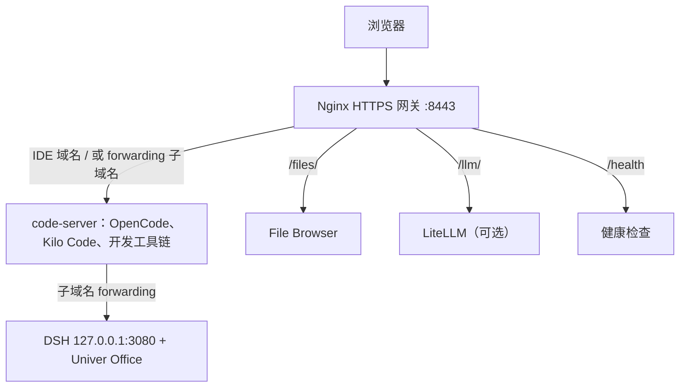

# Agentic 云开发环境

内网私有化部署的 AI 嵌入式开发环境，提供 Web IDE、编程智能体、办公插件和嵌入式工具链。

## 组成与入口

| 组件 | 用途 | 默认地址 |
| --- | --- | --- |
| code-server | VS Code Web、OpenCode CLI、Kilo Code 扩展和开发工具链 | `https://localhost:8443/` |
| DSH + Univer Office | 在 IDE 终端运行 `dsh-web` 后使用办公智能体 | `https://3080.localhost:8443/`，首次打开终端输出的完整登录地址 |
| File Browser | 管理共享工作目录 | `https://localhost:8443/files/` |
| LiteLLM（可选） | 统一模型 API，使用 `--llm` 启用 | `https://localhost:8443/llm/` |

所有服务共用网关 HTTPS 端口，默认 8443。DSH 通过 code-server 的**子域名 forwarding** 访问，远程部署需要对应域名解析和受信任证书。



DSH 的 Viewer、API 和 WebSocket 保持同源根路径；无需专用 Nginx 规则，也不单独映射 3080 或内部 9080 端口。旧 `/dsh/` 和默认 `/proxy/3080/` 均不作为 Office 入口。

## 快速开始

以下命令在仓库根目录执行，首次构建需要联网。

Linux / macOS：

```bash
./scripts/manage.sh init
# 编辑 docker/.env：设置密码；远程 DSH 访问还需设置 forwarding 域名
./scripts/manage.sh pull
./scripts/manage.sh build
./scripts/manage.sh up
```

Windows PowerShell：

```powershell
.\scripts\manage.ps1 init
# 编辑 docker\.env
.\scripts\manage.ps1 pull
.\scripts\manage.ps1 build
.\scripts\manage.ps1 up
```

打开 IDE 地址，使用 `docker/.env` 中的 `CODE_SERVER_PASSWORD` 登录。首次启动会在缺少证书时自动生成证书；客户端须信任该证书，单纯跳过浏览器警告不足以保证扩展网页视图可用。详见 [HTTPS 与证书](docs/https.md)。

在 IDE 终端中：

```bash
opencode   # 配置提供商和模型后使用

dsh-web    # 保持终端运行，打开输出的完整登录链接；Ctrl+C 停止
```

Kilo Code 从侧边栏打开。OpenCode、Kilo Code 和 DSH 分别配置模型认证；DSH 在 **Settings → Models** 配置，并选择 `/workspace` 工作区。详细参数见 [配置指南](CONFIGURATION.md)。

## DSH、Office 与旧浏览器

镜像预装 DSH 和 web profile 的 `dsh-univer-office`，同时安装现代 Node.js、服务端 Chromium 和中文字体。Office 是 DSH 插件，无需安装 VSIX。

DSH、Office、pnpm 的构建参数默认均为 `latest`。Docker 缓存和已有 `dsh-data` 卷会影响实际安装版本；重新构建不等于已有卷中的插件已升级，操作见 [升级说明](CONFIGURATION.md#更新已有部署)。

本地兼容层在 DSH 主页面和独立 Office Viewer 启动前注入少量缺失 API。Linux 的真实 Chromium 108 与 156 已通过基础表格流程；Win7 真机、其他文档类型、完整模型流程和其他扩展仍需分别验收。当前方案、实际版本及测试边界集中在 [兼容性指南](docs/compatibility.md)。

## 开发工具与扩展

内置 ARM GCC 13.2、clang/clangd、CMake、cppcheck、GDB、OpenOCD、QEMU、Google Test、Ceedling、Sphinx 等工具，直接在 IDE 终端使用。Python 工具安装在 `/opt/dev-python` 虚拟环境中，该目录已加入 PATH。

AI 应用保留 OpenCode、Kilo Code、DSH + Office。Claude Code CLI/扩展、Cline 和 Roo Code 已从默认配置移除；启动时卸载旧扩展卷中的三个退役扩展，卸载逻辑不删除历史设置。重建前确认 [持久化与备份范围](CONFIGURATION.md#数据持久化)。

完整扩展列表和 seed/持久化卷规则见 [扩展说明](EXTENSIONS.md)；开发命令见 [快速参考](QUICKSTART.md)。

## 常用管理

| 操作 | Linux / macOS | Windows PowerShell |
| --- | --- | --- |
| 状态 | `./scripts/manage.sh status` | `.\scripts\manage.ps1 status` |
| 日志 | `./scripts/manage.sh logs code-server` | `.\scripts\manage.ps1 logs code-server` |
| 容器终端 | `./scripts/manage.sh shell code-server` | `.\scripts\manage.ps1 shell code-server` |
| 停止 | `./scripts/manage.sh down` | `.\scripts\manage.ps1 down` |
| 启用 LiteLLM | `./scripts/manage.sh up --llm` | `.\scripts\manage.ps1 up -Llm` |
| Docker-only 启动 | `./scripts/manage.sh up --docker-only` | `.\scripts\manage.ps1 up -DockerOnly` |
| 导出 / 导入镜像 | `./scripts/manage.sh save` / `load` | `.\scripts\manage.ps1 save` / `load` |

启用 LiteLLM 前，复制并编辑 `configs/litellm_config.yaml.example`，再配置 `.env` 中的模型地址和 Key。详见 [LiteLLM 配置](CONFIGURATION.md#可选-litellm-网关)。

离线部署应先在联网环境完成构建与 `save`，传输仓库和 `images/` 后执行 `load`、配置 `.env` 并 `up`。离线 VSIX 必须在构建前放入 `configs/vsix/`；具体步骤见 [离线安装说明](configs/vsix/README.md)。镜像内已含 DSH Office，日常启动无需重新下载插件。

## 文档

- [文档导航](docs/README.md)：使用指南、兼容性及历史调研入口。
- [配置指南](CONFIGURATION.md)：远程域名、数据卷、模型配置与升级。
- [快速参考](QUICKSTART.md)：命令、工具速查与常见问题。
- [HTTPS 与证书](docs/https.md)：SAN、客户端信任与证书更换。
- [扩展说明](EXTENSIONS.md)、[文件清单](MANIFEST.md)、[更新日志](docs/CHANGELOG.md)。
